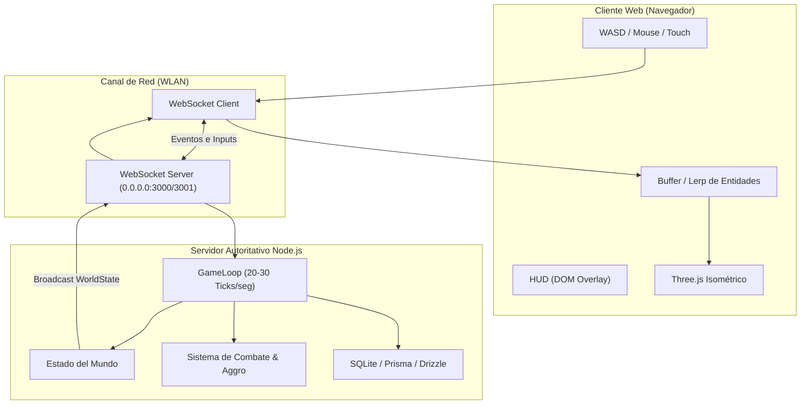

# Project Knowledge Graph (Grafify)

> **Generado automáticamente**: 2026-11-02T01:57:24.144Z
> **Propósito**: Mapa de alta velocidad para que agentes de IA y desarrolladores ubiquen componentes, flujos de red y responsabilidades sin tener que leer todo el proyecto.

## 1. Índice Rápido de Componentes y Archivos

| Archivo / Módulo | Extensión | Rol / Descripción |
| :--- | :--- | :--- |
| [`.agents/skills/game-netcode/SKILL.md`](file:///.agents/skills/game-netcode/SKILL.md) | `.md` | Game Netcode & Multiplayer 3D Web Guide |
| [`.agents/skills/grafify/SKILL.md`](file:///.agents/skills/grafify/SKILL.md) | `.md` | Skill: Grafify (Navegación e Índice Rápido del Proyecto) |
| [`.agents/skills/security-audit/AI-AND-LLM.md`](file:///.agents/skills/security-audit/AI-AND-LLM.md) | `.md` | AI, LLM, and Agent Hunting |
| [`.agents/skills/security-audit/ATTACK-CLASSES.md`](file:///.agents/skills/security-audit/ATTACK-CLASSES.md) | `.md` | Attack Classes |
| [`.agents/skills/security-audit/CLIENT-SIDE.md`](file:///.agents/skills/security-audit/CLIENT-SIDE.md) | `.md` | Client-Side and Browser Hunting |
| [`.agents/skills/security-audit/CLOUD-AND-DEPLOYMENT.md`](file:///.agents/skills/security-audit/CLOUD-AND-DEPLOYMENT.md) | `.md` | Cloud and Deployment Hunting |
| [`.agents/skills/security-audit/DATA-ISOLATION-AND-LIFECYCLE.md`](file:///.agents/skills/security-audit/DATA-ISOLATION-AND-LIFECYCLE.md) | `.md` | Data Isolation and Lifecycle Hunting |
| [`.agents/skills/security-audit/DESKTOP-MOBILE-AND-LOCAL-IPC.md`](file:///.agents/skills/security-audit/DESKTOP-MOBILE-AND-LOCAL-IPC.md) | `.md` | Desktop, Mobile, and Local IPC Hunting |
| [`.agents/skills/security-audit/HUNTING.md`](file:///.agents/skills/security-audit/HUNTING.md) | `.md` | Vulnerability Hunting |
| [`.agents/skills/security-audit/MEMORY-SAFETY-AND-BINARY.md`](file:///.agents/skills/security-audit/MEMORY-SAFETY-AND-BINARY.md) | `.md` | Memory Safety, Binary, and Kernel Hunting |
| [`.agents/skills/security-audit/PROTOCOLS-RPC-AND-MESSAGING.md`](file:///.agents/skills/security-audit/PROTOCOLS-RPC-AND-MESSAGING.md) | `.md` | Protocols, RPC, and Messaging Hunting |
| [`.agents/skills/security-audit/RECONNAISSANCE.md`](file:///.agents/skills/security-audit/RECONNAISSANCE.md) | `.md` | Reconnaissance |
| [`.agents/skills/security-audit/report-schema.json`](file:///.agents/skills/security-audit/report-schema.json) | `.json` | Source / Asset file |
| [`.agents/skills/security-audit/RESOURCE-EXHAUSTION-AND-AVAILABILITY.md`](file:///.agents/skills/security-audit/RESOURCE-EXHAUSTION-AND-AVAILABILITY.md) | `.md` | Resource Exhaustion and Availability Hunting |
| [`.agents/skills/security-audit/SKILL.md`](file:///.agents/skills/security-audit/SKILL.md) | `.md` | Security Audit |
| [`.agents/skills/security-audit/SUPPLY-CHAIN-AND-RELEASE.md`](file:///.agents/skills/security-audit/SUPPLY-CHAIN-AND-RELEASE.md) | `.md` | Supply Chain and Release Hunting |
| [`.agents/skills/security-audit/validate-coverage-ledger.cjs`](file:///.agents/skills/security-audit/validate-coverage-ledger.cjs) | `.cjs` | !/usr/bin/env node |
| [`.agents/skills/security-audit/validate-coverage-ledger.test.cjs`](file:///.agents/skills/security-audit/validate-coverage-ledger.test.cjs) | `.cjs` | Source / Asset file |
| [`.agents/skills/security-audit/validate-findings.cjs`](file:///.agents/skills/security-audit/validate-findings.cjs) | `.cjs` | !/usr/bin/env node |
| [`.agents/skills/security-audit/validate-findings.test.cjs`](file:///.agents/skills/security-audit/validate-findings.test.cjs) | `.cjs` | Source / Asset file |
| [`.agents/skills/security-audit/VALIDATION-AND-REPORTING.md`](file:///.agents/skills/security-audit/VALIDATION-AND-REPORTING.md) | `.md` | Validation, Structured Output, Verification, and Reporting |
| [`.agents/skills/security-audit/WEB-PROTOCOL-AND-AUTH.md`](file:///.agents/skills/security-audit/WEB-PROTOCOL-AND-AUTH.md) | `.md` | HTTP-Protocol and Authentication Hunting |
| [`.gitignore`](file:///.gitignore) | `none` | Dependencias |
| [`documentacion/plan_maestro_de_desarrollo_f1.md`](file:///documentacion/plan_maestro_de_desarrollo_f1.md) | `.md` | Master Game Document: RPG Cooperativo WLAN / Futuro MMORPG Cloud |
| [`documentacion/plan_maestro_de_desarrollo_f2.md`](file:///documentacion/plan_maestro_de_desarrollo_f2.md) | `.md` | Master Game Document & Bootstrap: RPG Cooperativo WLAN / Futuro MMORPG Cloud |
| [`GEMINI.md`](file:///GEMINI.md) | `.md` | Reglas del Proyecto: RPG Cooperativo WLAN / MMORPG |
| [`package.json`](file:///package.json) | `.json` | Source / Asset file |
| [`packages/client/index.html`](file:///packages/client/index.html) | `.html` | Source / Asset file |
| [`packages/client/package.json`](file:///packages/client/package.json) | `.json` | Source / Asset file |
| [`packages/client/src/core/AssetManager.ts`](file:///packages/client/src/core/AssetManager.ts) | `.ts` | Source / Asset file |
| [`packages/client/src/core/Engine.ts`](file:///packages/client/src/core/Engine.ts) | `.ts` | Source / Asset file |
| [`packages/client/src/entities/MonsterEntity.ts`](file:///packages/client/src/entities/MonsterEntity.ts) | `.ts` | Source / Asset file |
| [`packages/client/src/entities/ObstacleRenderer.ts`](file:///packages/client/src/entities/ObstacleRenderer.ts) | `.ts` | Source / Asset file |
| [`packages/client/src/entities/PlayerEntity.ts`](file:///packages/client/src/entities/PlayerEntity.ts) | `.ts` | Source / Asset file |
| [`packages/client/src/entities/RangeIndicator.ts`](file:///packages/client/src/entities/RangeIndicator.ts) | `.ts` | Source / Asset file |
| [`packages/client/src/input/InputManager.ts`](file:///packages/client/src/input/InputManager.ts) | `.ts` | Source / Asset file |
| [`packages/client/src/main.ts`](file:///packages/client/src/main.ts) | `.ts` | Source / Asset file |
| [`packages/client/src/network/NetworkClient.ts`](file:///packages/client/src/network/NetworkClient.ts) | `.ts` | Source / Asset file |
| [`packages/client/src/ui/CharacterLoginModal.ts`](file:///packages/client/src/ui/CharacterLoginModal.ts) | `.ts` | Source / Asset file |
| [`packages/client/src/ui/CombatHUD.ts`](file:///packages/client/src/ui/CombatHUD.ts) | `.ts` | Source / Asset file |
| [`packages/client/src/ui/FloatingText.ts`](file:///packages/client/src/ui/FloatingText.ts) | `.ts` | Source / Asset file |
| [`packages/client/src/ui/HUD.ts`](file:///packages/client/src/ui/HUD.ts) | `.ts` | Source / Asset file |
| [`packages/client/src/ui/SettingsMenu.ts`](file:///packages/client/src/ui/SettingsMenu.ts) | `.ts` | Source / Asset file |
| [`packages/client/tsconfig.json`](file:///packages/client/tsconfig.json) | `.json` | Source / Asset file |
| [`packages/client/tsconfig.tsbuildinfo`](file:///packages/client/tsconfig.tsbuildinfo) | `.tsbuildinfo` | Source / Asset file |
| [`packages/client/vite.config.ts`](file:///packages/client/vite.config.ts) | `.ts` | Source / Asset file |
| [`packages/common/package.json`](file:///packages/common/package.json) | `.json` | Source / Asset file |
| [`packages/common/src/constants/index.ts`](file:///packages/common/src/constants/index.ts) | `.ts` | Source / Asset file |
| [`packages/common/src/index.ts`](file:///packages/common/src/index.ts) | `.ts` | Source / Asset file |
| [`packages/common/src/network/index.ts`](file:///packages/common/src/network/index.ts) | `.ts` | Source / Asset file |
| [`packages/common/src/types/index.ts`](file:///packages/common/src/types/index.ts) | `.ts` | Source / Asset file |
| [`packages/common/tsconfig.json`](file:///packages/common/tsconfig.json) | `.json` | Source / Asset file |
| [`packages/common/tsconfig.tsbuildinfo`](file:///packages/common/tsconfig.tsbuildinfo) | `.tsbuildinfo` | Source / Asset file |
| [`packages/server/dev.db`](file:///packages/server/dev.db) | `.db` | Source / Asset file |
| [`packages/server/package.json`](file:///packages/server/package.json) | `.json` | Source / Asset file |
| [`packages/server/src/db/DatabaseManager.ts`](file:///packages/server/src/db/DatabaseManager.ts) | `.ts` | @ts-ignore |
| [`packages/server/src/game/CombatSystem.ts`](file:///packages/server/src/game/CombatSystem.ts) | `.ts` | Source / Asset file |
| [`packages/server/src/game/GameWorld.ts`](file:///packages/server/src/game/GameWorld.ts) | `.ts` | Source / Asset file |
| [`packages/server/src/game/MapManager.ts`](file:///packages/server/src/game/MapManager.ts) | `.ts` | Source / Asset file |
| [`packages/server/src/game/Monster.ts`](file:///packages/server/src/game/Monster.ts) | `.ts` | Source / Asset file |
| [`packages/server/src/game/Player.ts`](file:///packages/server/src/game/Player.ts) | `.ts` | Source / Asset file |
| [`packages/server/src/index.ts`](file:///packages/server/src/index.ts) | `.ts` | Source / Asset file |
| [`packages/server/src/network/NetworkServer.ts`](file:///packages/server/src/network/NetworkServer.ts) | `.ts` | Source / Asset file |
| [`packages/server/tsconfig.json`](file:///packages/server/tsconfig.json) | `.json` | Source / Asset file |
| [`packages/server/tsconfig.tsbuildinfo`](file:///packages/server/tsconfig.tsbuildinfo) | `.tsbuildinfo` | Source / Asset file |
| [`scripts/grafify.js`](file:///scripts/grafify.js) | `.js` | !/usr/bin/env node |
| [`tsconfig.base.json`](file:///tsconfig.base.json) | `.json` | Source / Asset file |
| [`tsconfig.json`](file:///tsconfig.json) | `.json` | Source / Asset file |

## 2. Mapa de Arquitectura y Flujo

## 3. Matriz de Conceptos Clave -> Archivos

- **Reglas y Visión:** [`GEMINI.md`](file:///GEMINI.md), [`documentacion/plan_maestro_de_desarrollo_f1.md`](file:///documentacion/plan_maestro_de_desarrollo_f1.md), [`documentacion/plan_maestro_de_desarrollo_f2.md`](file:///documentacion/plan_maestro_de_desarrollo_f2.md)
- **Netcode y Ticks:** [`.agents/skills/game-netcode/SKILL.md`](file:///.agents/skills/game-netcode/SKILL.md)
- **Seguridad:** [`.agents/skills/security-audit/SKILL.md`](file:///.agents/skills/security-audit/SKILL.md)
- **Mapeo de Proyecto:** [`scripts/grafify.js`](file:///scripts/grafify.js), [`PROJECT_GRAPH.md`](file:///PROJECT_GRAPH.md)

