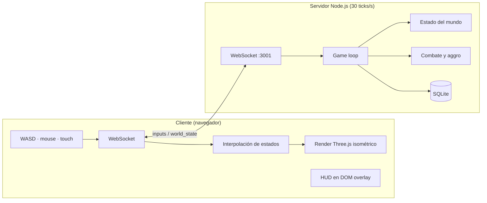

# ⚔️ migame: RPG cooperativo 3D en red local

Juego de rol multijugador en tiempo real con vista isométrica 3D, inspirado en *Albion Online*, *World of Warcraft* y *Diablo*. Pensado para jugar de 2 a 6 personas en la misma red Wi-Fi, desde el navegador del PC, la laptop, la tablet o el celular, sin instalar nada y sin servidores en la nube.


---

## 🎮 Qué puedes hacer

- **Tres clases:** Guerrero (tanque), Clérigo (curación) y Mago (daño a distancia). Puedes cambiar de rol en partida, con un enfriamiento de 6 s.
- **Combate en tiempo real:** hechizos de daño y curación con *cooldowns*, selección de objetivo e indicador de rango.
- **Monstruos con IA:** sistema de *aggro*, persecución y reaparición.
- **Progresión:** experiencia, subida de nivel y hechizos que escalan un +8 % de poder por nivel.
- **Mundo por zonas:** Cripta, Bosque, Volcán y Vacío, conectadas por portales.
- **Personajes persistentes:** el nivel, la experiencia, el oro y la zona se guardan en SQLite.
- **Multi-dispositivo:** se juega con teclado (WASD o flechas) y mouse. La interfaz está preparada para pantallas táctiles.

## 🏗️ Arquitectura

El servidor es **autoritativo** ("never trust the client"): el cliente solo envía intenciones (moverse, lanzar un hechizo) y el servidor calcula movimiento, colisiones, daño, cooldowns y persistencia.



El proyecto es un **monorepo con npm workspaces**:

| Paquete | Rol |
| :-- | :-- |
| `packages/client` | Motor de render (Three.js + Vite), entidades, entrada, HUD y cliente de red |
| `packages/server` | Game loop, mundo, combate, monstruos, mapas y persistencia (Express + `ws` + `node:sqlite`) |
| `packages/common` | Tipos, constantes y protocolo de red compartidos entre cliente y servidor, tipados de punta a punta |

## 🚀 Cómo jugar

**Requisitos:** Node.js **22.5 o superior**, porque el servidor usa el módulo nativo `node:sqlite`.

```bash
git clone https://github.com/Gandalfs3/migame.git
cd migame
npm install
npm run dev
```

Esto levanta el servidor en el puerto `3001` y el cliente en el `3000`.

- **En tu PC:** abre `http://localhost:3000`.
- **Otros dispositivos de la casa:** conéctalos a la misma red Wi-Fi y abre `http://<IP-de-tu-PC>:3000`. La IP aparece en el menú de ajustes del juego, con un botón para compartir el enlace.

> Si los otros dispositivos no logran conectarse, permite Node.js en el firewall de Windows para redes privadas.

## 🗺️ Hoja de ruta

- [x] Movimiento multijugador sincronizado con interpolación
- [x] Clases, hechizos, combate y monstruos con aggro
- [x] Niveles, experiencia y persistencia en SQLite
- [x] Zonas y portales
- [ ] Inventario y botín
- [ ] Despliegue en la nube con PostgreSQL y PvP masivo

La visión completa está en [`documentacion/`](documentacion/).

## 👤 Autor

Creado por **Franklin Ortiz** ([@Gandalfs3](https://github.com/Gandalfs3)), desarrollador fullstack.
